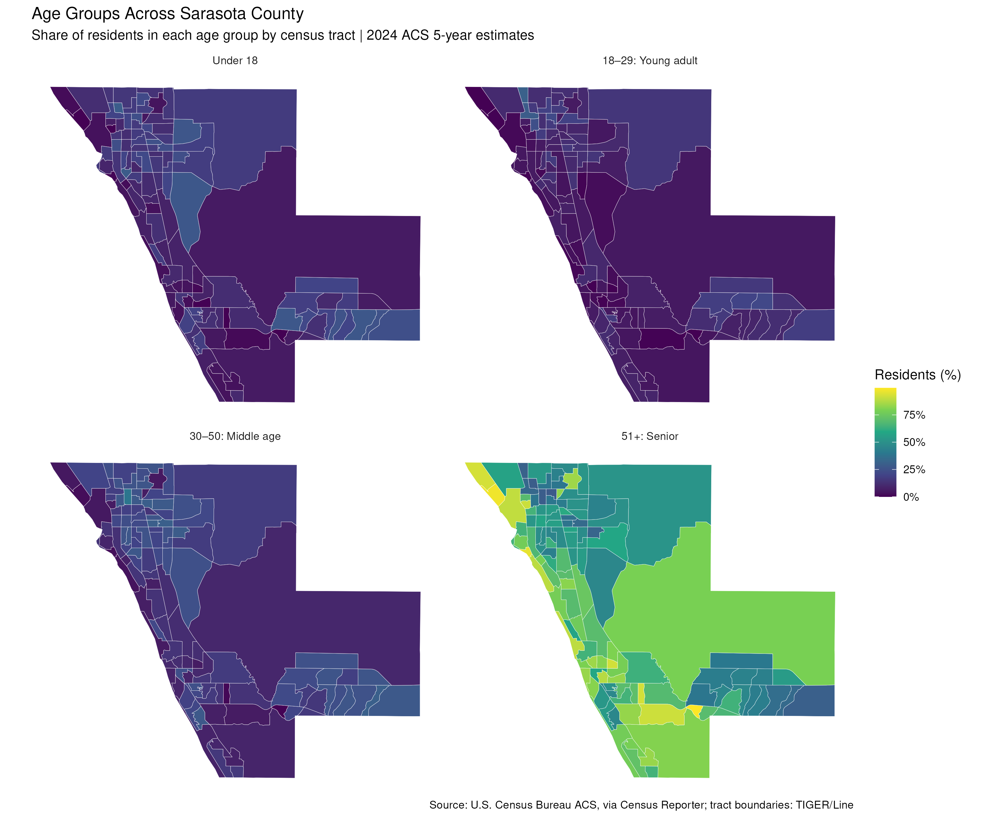
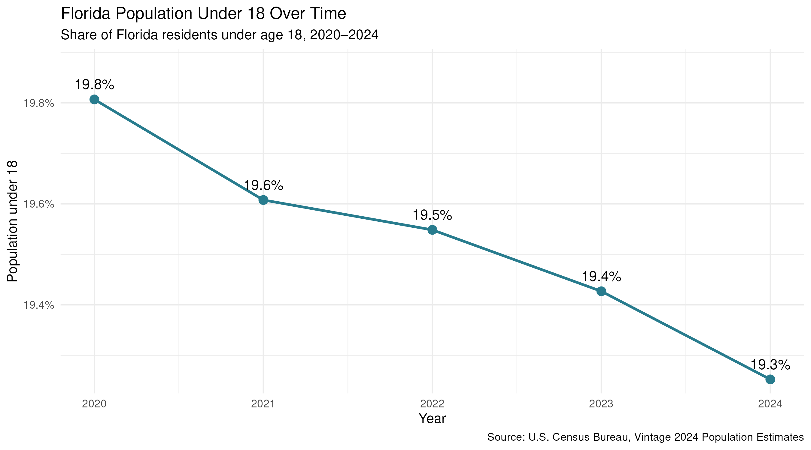

## Age Groups Across Sarasota County

Each panel maps the estimated share of residents in an age group for each
Sarasota County census tract, based on the 2024 American Community Survey
5-year estimates.

The Census groups ages 50–54 together. For this map, one-fifth of that group is
estimated as age 50 and the remaining four-fifths as ages 51–54.

Source: U.S. Census Bureau American Community Survey, via Census Reporter;
tract boundaries from TIGER/Line.

## Florida's Under-18 Population Over Time

This line graph shows the estimated statewide share of Florida residents under
age 18 from 2020 through 2024.

Source: U.S. Census Bureau, Vintage 2024 Population Estimates.
